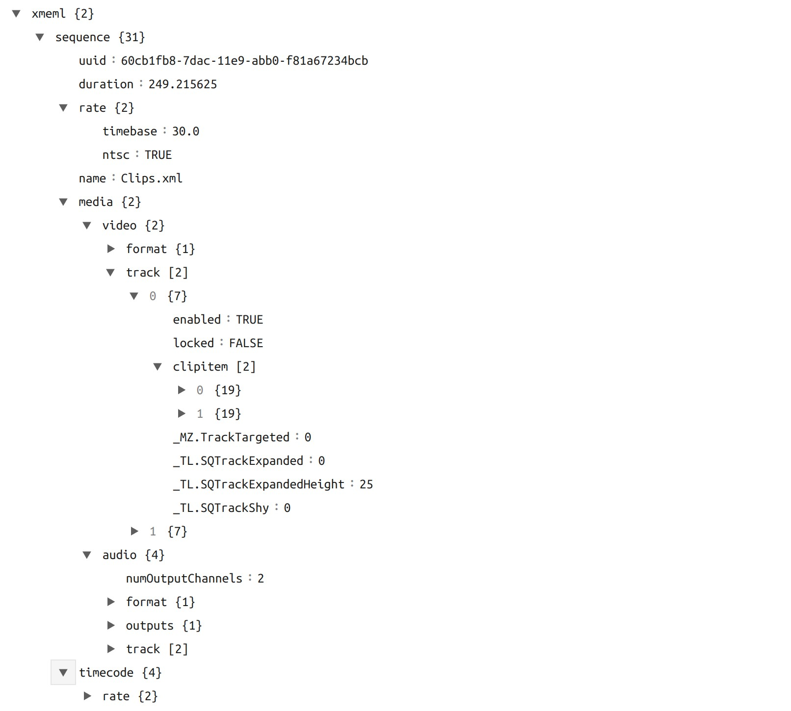

.. Copyright (c) 2008-2026 OpenShot Studios, LLC
 (http://www.openshotstudios.com). This file is part of
 OpenShot Video Editor (http://www.openshot.org), an open-source project
 dedicated to delivering high quality video editing and animation solutions
 to the world.

.. OpenShot Video Editor is free software: you can redistribute it and/or modify
 it under the terms of the GNU General Public License as published by
 the Free Software Foundation, either version 3 of the License, or
 (at your option) any later version.

.. OpenShot Video Editor is distributed in the hope that it will be useful,
 but WITHOUT ANY WARRANTY; without even the implied warranty of
 MERCHANTABILITY or FITNESS FOR A PARTICULAR PURPOSE.  See the
 GNU General Public License for more details.

.. You should have received a copy of the GNU General Public License
 along with OpenShot Library.  If not, see <http://www.gnu.org/licenses/>.

Import & Export
===============

Use **EDL** or **Final Cut Pro XML** to move edits between OpenShot and another video editor. These files describe
clip placement, trims, and supported keyframes; they do not contain your media or preserve every editing feature.
Keep an :guilabel:`OpenShot Project (*.osp)` copy for continued editing in OpenShot.

For importing video, audio, or images, see :ref:`import_files_ref`. To render a finished video, audio file,
or image sequence, see :doc:`export`.

Transfer a Timeline
-------------------

1. Save your project. Before importing, choose a project profile matching the source timeline's frame rate and
   dimensions; import uses the current project settings to interpret timing and placement.
2. Choose :guilabel:`File → Import Project` or :guilabel:`File → Export Project`, then choose **EDL** or
   **XML (Final Cut Pro)**. Import adds tracks to the current project; start a new project if you want a separate timeline.
3. Keep the original media available. The interchange file references media paths rather than copying files.
   If prompted for missing media, locate the original files.
4. Review the imported timeline, especially timing, audio, and animated properties. Transitions, effects, text,
   and speed changes may need rebuilding in the other editor. Render those sections first if you need to preserve
   their finished appearance.

EDL (Edit Decision Lists)
-------------------------
The following features are supported when importing and exporting an EDL file with OpenShot.

.. table::
   :widths: 25 80

   ====================  ============
   EDL Option Name       Description
   ====================  ============
   EDL Format            CMX-3600 (a very widely supported variation)
   Tracks                Export writes one EDL file per nonempty track. Import each file separately to recreate several tracks.
   Tape Name             AX identifies media by default; other reel names are accepted. BL represents a gap.
   Edits (V and A)       Only edits are currently supported (transitions are not yet supported)
   Opacity               Opacity keyframes are supported
   Audio Levels          Volume keyframes are supported
   Transforms            Scale, location, rotation, and shear keyframes use OpenShot-specific comments. Other editors may ignore them.
   ====================  ============

Example EDL Output
^^^^^^^^^^^^^^^^^^

This example is one track at **24 fps**, with a one-second gap followed by a two-second video clip with audio.
The media file ``clip.mp4`` is beside the EDL file. OpenShot includes opacity, volume, and transform keyframes
as comment lines; other editors may ignore these extensions.

.. code-block:: text

   TITLE: Example - Main
   FCM: NON-DROP FRAME

   001  BL       V     C        00:00:00:00 00:00:01:00 00:00:00:00 00:00:01:00
   002  AX       V     C        00:00:00:00 00:00:02:00 00:00:01:00 00:00:03:00
   002  AX       A     C        00:00:00:00 00:00:02:00 00:00:01:00 00:00:03:00
   * FROM CLIP NAME: clip.mp4
   * SOURCE FILE: clip.mp4
   * VIDEO LEVEL AT 00:00:00:00 IS 50% BEZIER (REEL AX V)
   * AUDIO LEVEL AT 00:00:00:00 IS -6.02 DB LINEAR (REEL AX A1)
   * SCALE X AT 00:00:00:00 IS 125% LINEAR (REEL AX V)

XML (Final Cut Pro format)
--------------------------
OpenShot imports and exports legacy Final Cut Pro XML (**xmeml**); export writes version 4. Choose a compatible
legacy XML option in the other editor. Modern Final Cut Pro **FCPXML** (``*.fcpxml``) is a different format and
is not supported. These import/export commands also do not support AAF or OpenTimelineIO files.

.. table::
   :widths: 25 80

   ====================  ============
   XML Option Name       Description
   ====================  ============
   XML Format            Legacy Final Cut Pro XML (xmeml), also supported by other editors
   All Tracks            All video and audio tracks are supported
   Edits                 All clips on all tracks are supported (video, image, and audio files). Transitions are not yet supported.
   Opacity               Opacity keyframes are supported
   Audio Levels          Volume keyframes are supported
   Transforms            Position, uniform scale, and rotation keyframes are supported. Separate X/Y scales are combined on export; shear is not transferred.
   ====================  ============

Example XML Output (tree view)
^^^^^^^^^^^^^^^^^^^^^^^^^^^^^^

