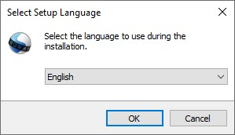
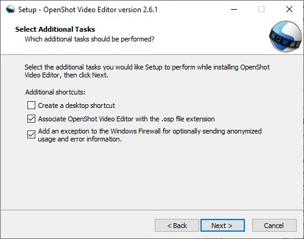
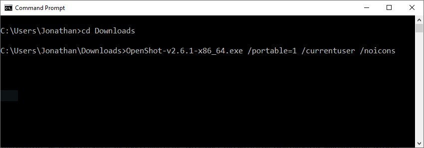
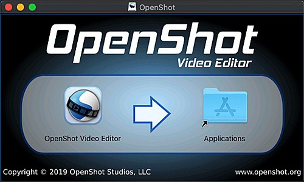
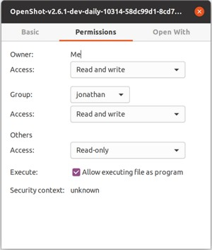

.. Copyright (c) 2008-2026 OpenShot Studios, LLC
 (http://www.openshotstudios.com). This file is part of
 OpenShot Video Editor (http://www.openshot.org), an open-source project
 dedicated to delivering high quality video editing and animation solutions
 to the world.

.. OpenShot Video Editor is free software: you can redistribute it and/or modify
 it under the terms of the GNU General Public License as published by
 the Free Software Foundation, either version 3 of the License, or
 (at your option) any later version.

.. OpenShot Video Editor is distributed in the hope that it will be useful,
 but WITHOUT ANY WARRANTY; without even the implied warranty of
 MERCHANTABILITY or FITNESS FOR A PARTICULAR PURPOSE.  See the
 GNU General Public License for more details.

.. You should have received a copy of the GNU General Public License
 along with OpenShot Library.  If not, see <http://www.gnu.org/licenses/>.

Installation
============

The latest official **stable** version of OpenShot Video Editor for Linux,
Mac, Chrome OS, and Windows can be downloaded from the official download page at
https://www.openshot.org/download/. You can find our latest **unstable** versions
(i.e. daily builds) at https://www.openshot.org/download#daily (these versions are
updated very frequently, and often contain many improvements not yet released in our stable
build).

Clean Install
^^^^^^^^^^^^^

Upgrading normally preserves your preferences. If OpenShot fails to launch or you want to start with
**default preferences**, see :ref:`preferences_reset_ref`. A reset is not required for a normal upgrade.

Windows (Microsoft Store)
^^^^^^^^^^^^^^^^^^^^^^^^^

On Windows 10 or 11, open the official `OpenShot Microsoft Store listing
<https://apps.microsoft.com/detail/9P6R2PMH4C04>`_, complete the purchase, and install OpenShot.
Launch it from the Start menu. The Store handles updates automatically.

The Store purchase supports OpenShot development. The free installer below provides the same editing features.

Windows (Installer)
^^^^^^^^^^^^^^^^^^^

Download the Windows installer from the `official download page
<https://www.openshot.org/download/>`_ (the download page contains both 64-bit and
32-bit versions), double click it, and follow the directions on screen. Once completed,
OpenShot will be installed and available in your Start menu. To update, download and run a newer installer.

Windows (Portable)
^^^^^^^^^^^^^^^^^^

If you need to install OpenShot on Windows without Administrator permissions,
we also support a portable installation process. Download the Windows installer
from the `official download page <https://www.openshot.org/download/>`_, open the command prompt,
and type the following commands. Replace ``OpenShot-installer.exe`` with the name of the downloaded file:

..  code-block:: console

    cd /d "%USERPROFILE%\Downloads"
    OpenShot-installer.exe /portable=1 /currentuser /noicons

Mac
^^^

Download the DMG file from the `official download page
<https://www.openshot.org/download/>`_, double click it, and then drag the OpenShot application
icon into your **Applications** shortcut. This is very similar to how most Mac applications are
installed. Now launch OpenShot from `Launchpad` or `Applications` in Finder.

The current Mac download is built for Intel Macs. On an Apple Silicon Mac, you
can run this Intel version using Rosetta. A native Apple Silicon version is planned
for a future release.

Linux (Snap)
^^^^^^^^^^^^

Install the official ``openshot-qt`` package from the `Snap Store <https://snapcraft.io/openshot-qt>`_,
or run the command below. If your distribution does not include Snap support, first follow the
`snapd setup instructions <https://snapcraft.io/docs/installing-snapd/>`_.

.. code-block:: console

    sudo snap install openshot-qt

Launch OpenShot from your applications menu. Snap handles updates automatically.

If external drives, microphone recording, or webcam capture are unavailable, enable the corresponding
permissions in your software manager. You can also grant the permissions you need in a terminal:

.. code-block:: console

    sudo snap connect openshot-qt:removable-media
    sudo snap connect openshot-qt:audio-record
    sudo snap connect openshot-qt:camera

Linux (AppImage)
^^^^^^^^^^^^^^^^

Most Linux distributions have a version of OpenShot in their software
repositories, which can be installed using your package manager / software store.
These versions can differ from the current OpenShot release; check :guilabel:`Help→About OpenShot`.
For a portable version you can run without installing, download an AppImage from the
`official download page <https://www.openshot.org/download/>`_. To update, download a newer AppImage.

Once downloaded, right click on the AppImage, choose Properties, and mark the file as **Executable**.
Finally, double click the AppImage to launch OpenShot. If double clicking does not launch OpenShot, you can also
right click on the AppImage, and choose `Execute` or `Run`. For a detailed guide on installing our AppImage
and creating a launcher for it, see our
`AppImage Installation Guide <https://github.com/OpenShot/openshot-qt/wiki/AppImage-Installation>`_.

Unable to Launch AppImage?
~~~~~~~~~~~~~~~~~~~~~~~~~~
If an AppImage reports a missing FUSE library, install the FUSE 2 compatibility library.
On Ubuntu 24.04 and newer:

..  code-block:: console

    sudo apt install libfuse2t64

On Ubuntu 22.04, use ``sudo apt install libfuse2``. For other distributions, see the
`AppImage FUSE instructions <https://docs.appimage.org/user-guide/troubleshooting/fuse.html>`_.

Install AppImage Launcher
~~~~~~~~~~~~~~~~~~~~~~~~~
If you plan on using OpenShot often, you will probably want an integrated launcher for our AppImage.
`AppImageLauncher <https://github.com/TheAssassin/AppImageLauncher>`_ is an optional tool for adding
AppImages to your applications menu. Follow its installation instructions for your distribution.

For command-line editing and automation, see :ref:`cli_ref`. If AppImageLauncher
shows integration dialogs when using ``--cli``, follow the environment-variable
instructions in :ref:`cli_appimage_ref`.

Linux (PPA)
^^^^^^^^^^^

For supported Ubuntu versions and compatible derivatives such as Linux Mint, we also have a PPA
(Personal Package Archive), which adds our official OpenShot software repository to your package
manager. Check the `PPA's available packages <https://launchpad.net/~openshot.developers/+archive/ubuntu/ppa>`_
for your Ubuntu version; package versions may differ from the AppImage and Snap releases.

Stable PPA (Contains only official releases)
~~~~~~~~~~~~~~~~~~~~~~~~~~~~~~~~~~~~~~~~~~~~

..  code-block:: console

    sudo add-apt-repository ppa:openshot.developers/ppa
    sudo apt update
    sudo apt install openshot-qt python3-openshot

Daily PPA (Highly experimental and unstable, for testers)
~~~~~~~~~~~~~~~~~~~~~~~~~~~~~~~~~~~~~~~~~~~~~~~~~~~~~~~~~

..  code-block:: console

    sudo add-apt-repository ppa:openshot.developers/libopenshot-daily
    sudo apt update
    sudo apt install openshot-qt python3-openshot

Chrome OS (Chromebook)
^^^^^^^^^^^^^^^^^^^^^^

Chrome OS supports Linux apps, but this feature is off by default. You can turn it on in *Settings*.
Once Linux is enabled, you can install and run OpenShot Linux AppImages on any *x86-based*
Chromebook. The command below will download our AppImage and configure your system to run
OpenShot successfully.

- Navigate to *chrome://os-settings/crostini* (Copy/Paste)
- Under :guilabel:`Linux development environment`, select :guilabel:`Set up`.
- When the Terminal appears, run:

.. code-block:: console

    bash <(wget -O - https://www.openshot.org/files/chromeos/install-stable.sh)

Previous Versions
^^^^^^^^^^^^^^^^^

To download old versions of OpenShot Video Editor, you can visit https://github.com/OpenShot/openshot-qt/tags.
Click on the version number you need, and scroll to the bottom, under the release notes. You will find
download links for each operating system. Download the appropriate version for your computer, and
follow the installation instructions above.

NOTE: Projects (\*.osp) made with newer versions of OpenShot Video Editor might not support older versions.

Uninstall
^^^^^^^^^

Remove OpenShot using the method you used to install it. You do not need to delete your projects or media.
Preferences and recovery files may remain after uninstalling. If you also want to remove those, first back up
any recovery files you need, then see :ref:`preferences_reset_ref` for the settings folder location.

Windows
~~~~~~~

#. Open **Settings** from the Start menu
#. Go to **Apps** and find OpenShot Video Editor
#. Choose **Uninstall** (works for both the Store version and the regular installer)

For a portable installation, delete the folder where you installed OpenShot.

Mac
~~~

#. Open **Finder** and go to **Applications**
#. Drag the OpenShot Video Editor icon to the **Trash** in the Dock
#. Right-click **Trash** and choose **Empty Trash**

Linux
~~~~~

- **Snap:** remove it in your software manager, or run ``sudo snap remove openshot-qt``.
- **AppImage:** delete the ``*.AppImage`` file. If you used AppImageLauncher, choose **Remove AppImage from System**.
- **PPA or distribution package:** remove OpenShot in your package manager, or run ``sudo apt remove openshot-qt`` on Ubuntu.
