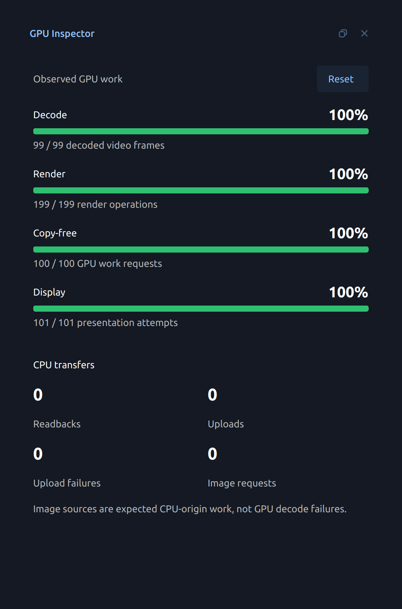

.. Copyright (c) 2008-2026 OpenShot Studios, LLC
 (http://www.openshotstudios.com). This file is part of
 OpenShot Video Editor (http://www.openshot.org), an open-source project
 dedicated to delivering high quality video editing and animation solutions
 to the world.

.. OpenShot Video Editor is free software: you can redistribute it and/or modify
 it under the terms of the GNU General Public License as published by
 the Free Software Foundation, either version 3 of the License, or
 (at your option) any later version.

.. OpenShot Video Editor is distributed in the hope that it will be useful,
 but WITHOUT ANY WARRANTY; without even the implied warranty of
 MERCHANTABILITY or FITNESS FOR A PARTICULAR PURPOSE.  See the
 GNU General Public License for more details.

.. You should have received a copy of the GNU General Public License
 along with OpenShot Library.  If not, see <http://www.gnu.org/licenses/>.

.. _playback_ref:

Playback
========
The preview window is where video & audio playback takes place in OpenShot Video Editor. The preview window
utilizes real-time video rendering, caching, re-sampling, and image scaling. This is the primary area for watching
back (and listening to) your edits, giving you the feedback needed to make adjustments. It is also one of the most
costly operations to your CPU, and requires a modern computer and some reasonable assumptions and factors (listed below).

To watch a file or choose a section before adding it to the timeline, right-click
it in Project Files and choose :guilabel:`Preview File` or :guilabel:`Split File`.
See :ref:`source_preview_ref`.

Real-Time Preview
-----------------
Many factors affect how smoothly the **real-time video preview** plays, including CPU speed, available memory,
and GPU support. The important factors are listed below.

.. table::
   :widths: 22 80

   ==================  ============
   Factor              Description
   ==================  ============
   CPU                 If your CPU is too slow or has too few cores, you will likely experience a slow, choppy preview.
                       We recommend installing OpenShot on fairly modern computer. See :ref:`min_system_req_ref` for
                       more details on the hardware requirements for OpenShot Video Editor.
   Memory              If your available RAM memory is too limited, you will likely see huge drops in real-time
                       performance, and your entire system will lag. We recommend installing additional RAM in your
                       computer, if possible. See :ref:`min_system_req_ref`.
   Cache               Caching prepares frames ahead of playback. It can absorb short slowdowns, but cannot sustain smooth
                       playback if frames take too long to render. Vulkan can keep video frames in GPU memory; CPU processing
                       uses system RAM. See :ref:`preferences_cache_ref` for memory budgets and buffering controls.
   Preview Size        The height x width of your preview dock (widget) is very important for smooth real-time previews.
                       The larger the window size, the more pixels must be rendered per frame, and the more CPU and RAM
                       are required, along with GPU memory when using Vulkan. It is recommended to keep reducing the preview window size until you achieve smooth
                       video playback. On a slower computer, the preview window size might need to be very small for
                       real-time previews (i.e. 320 x 240).
   Profile             Choose the project profile for your intended video. To improve editing speed, try a smaller preview
                       or optimized videos before changing the project's resolution or frame rate. See :ref:`profiles_ref`.
   FPS (Frame Rate)    The FPS of your project is also very important, and a large factor for smooth video playback. For
                       example, a 60 FPS video must render twice the number of frames, compared to a 30 FPS video.
                       Choose a lower project FPS only if it suits your final video; it changes how smooth motion looks.
   Matching Rates      OpenShot converts source frame rates and audio sample rates to the project settings when needed.
                       Matching your main footage can reduce conversion work. Check source rates under
                       :guilabel:`File Properties`; see :ref:`file_properties_ref`.
   Source Assets       Large or difficult-to-decode videos, such as 4K 60 FPS footage, can strain your system. Use
                       :guilabel:`Optimize` or :guilabel:`File → Auto-Optimize` to create smaller editing copies.
                       Exports still use the originals. See :ref:`optimize_ref`.
   Audio Device        If you are still having issues with audio lag or sync, please verify you are using the correct
                       :guilabel:`Playback Audio Device` for playback (in the OpenShot Preferences). See :ref:`preferences_preview_ref`. Verify
                       your default audio device (on your operating system) is using the same sample rate and all *Audio Enhancements* are disabled. On
                       certain operating systems (such as Windows), mismatching sample rates or audio enhancements can cause severe audio
                       / video sync problems. Lastly, try adjusting the :guilabel:`Playback Audio Buffer Size` (lower values
                       will playback audio with less delay, higher values will playback audio with a larger delay). OpenShot
                       defaults to a buffer size of 512, which is reasonable for most systems, however on some systems you
                       might need to lower (or raise) this value for smooth and lag-free audio playback. Be sure to restart
                       OpenShot after changing the audio playback settings.
   ==================  ============

.. _gpu_inspector_ref:

GPU Inspector
-------------

Click the four GPU indicators below the video preview to open :guilabel:`GPU Inspector`. Play a few seconds to
collect measurements. :guilabel:`Reset` clears the measurements so you can check a different clip or effect.

- **Read / Decode** shows GPU video decoding; **Process / Render** shows GPU video rendering.
- **Copy-free** shows how much measured work avoids image transfers between GPU and CPU.
- **Display** shows GPU presentation of the preview. During export, **Encode** replaces Display.

Green indicates mostly GPU work, amber indicates CPU involvement, and gray means there is not enough data yet or
measurements are unavailable. These percentages describe observed work, not GPU load or a speed increase.
:guilabel:`Readbacks` copy images from GPU to CPU; :guilabel:`Uploads` copy images in the other direction.
Software-decoded video, images, and changing text can need uploads, so CPU involvement is not automatically a problem.

GPU video processing does not move audio processing or initial tracking and object analysis onto Vulkan.
Those tasks can still use the CPU or their own processing-device settings.

Audio Troubleshooting
---------------------
If you are still experiencing audio related issues, and the above real-time playback factors did not resolve
your issue, here are some additional troubleshooting steps you can take.

.. table::
   :widths: 22 80

   ==================  ============
   Step                Description
   ==================  ============
   Latest Daily Build  Verify you are running the latest daily build of OpenShot: https://www.openshot.org/download#daily
   Clean Install       See :ref:`preferences_reset_ref` for a clean install
   Audio Device        Check that the Playback Audio Device is set correctly for your sound output under Preferences
                       in the Preview tab. Restart OpenShot after changing the settings. You can also try a different
                       audio device (USB, audio over HDMI from the video card, headphones, etc.) to rule out other audio issues.
                       Disable `automatic sound suppression` for voice calls during microphone activity, and disable
                       `Audio Enhancements` under the advanced settings tab of your audio device (not all audio devices
                       have these settings). See :ref:`preferences_preview_ref`.
   Audio Buffer Size   The audio buffer size is the amount of audio samples which must first be buffered in OpenShot before
                       audio playback can begin. If this value is too low, you might experience audio break-up / crackle / popping.
                       If this value is too high, you might experience delays or lag before audio playback begins. OpenShot
                       defaults this value to 512, which is a reasonable default for most systems, which should provide smooth
                       audio playback with minimal noticeable lag or delay. However, on some systems this value might need
                       to be adjusted up or down, for in-sync and lag-free audio playback. The range is 128 to 4096.
   Sample Rate         Ensure that the `Default Audio Sample Rate` and `Default Audio Channels` on the Preview tab of the
                       Preferences window match your hardware. You can also check these settings in the operating system
                       control panel (i.e. Windows Sound Control Panel). See :ref:`preferences_preview_ref`.
   Volume              Ensure that the volume does not exceed 100% on overlapping clips (such as an audio track combined
                       with a video track). Lower the volume on individual clips if needed. See :ref:`clip_volume_mixing_ref`.
   Headphones          If you're using headphones, plug them in before starting OpenShot. Launching OpenShot with no
                       speakers, headphones, or valid audio playback device can cause OpenShot to freeze during playback.
   OS Updates          Update your operating system and any pending security updates. Some audio issues, especially
                       audio device specific issues, can be resolved with an operating system update.
   ==================  ============

Smoother playback with optimized videos
---------------------------------------
If your source videos are difficult to play smoothly, enable
:menuselection:`File --> Auto-Optimize`. OpenShot identifies videos on your
computer using their recorded thumbnail timings, and creates smaller preview copies
for videos above the threshold in :menuselection:`Edit --> Preferences --> Optimize`. This
setting belongs to the current project and is saved with it. You can keep editing
while copies are created; exporting still uses your original files.

See :ref:`optimize_ref` for the banner, progress indicators, and manual optimization
options, or :ref:`preferences_optimize_ref` to adjust the threshold and default behavior.
